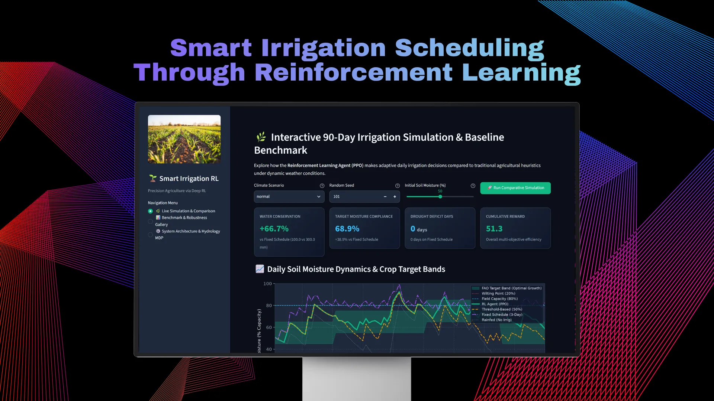
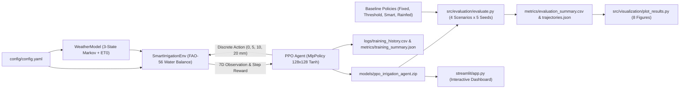
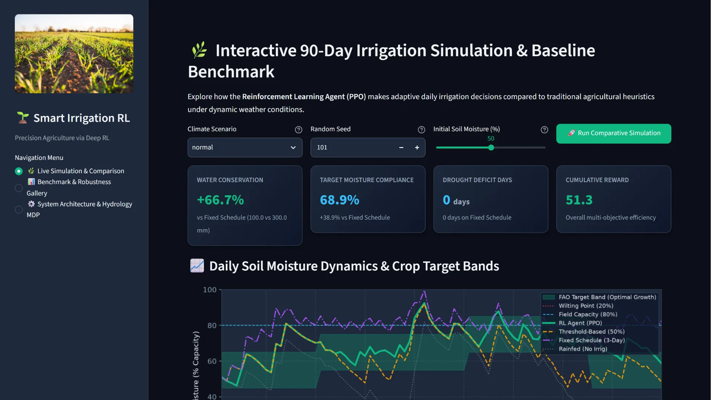
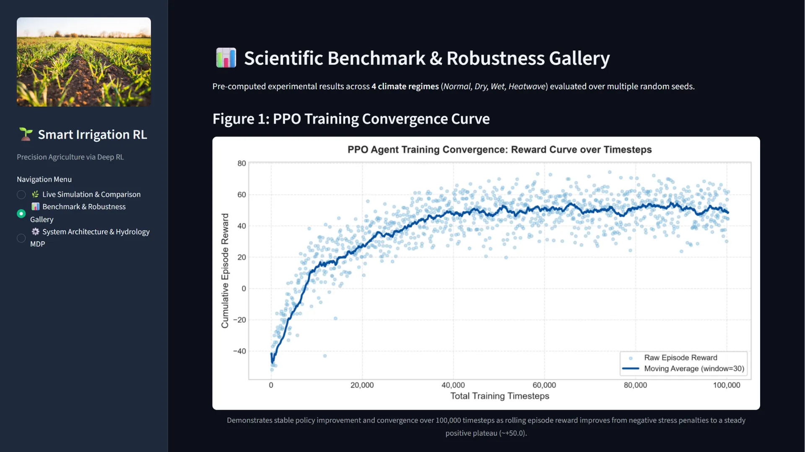
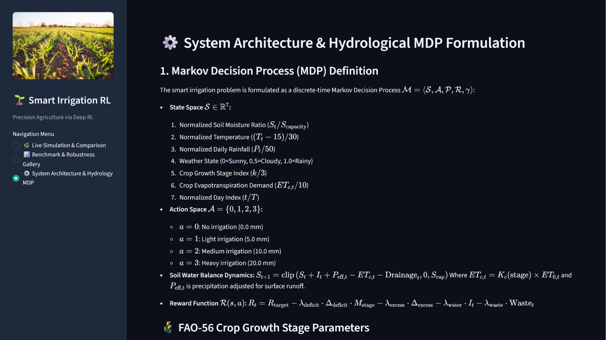
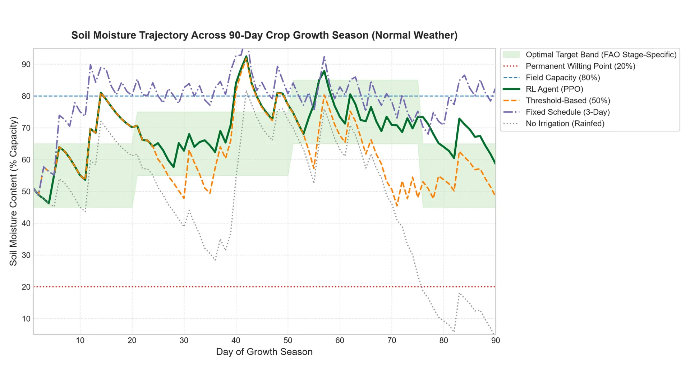
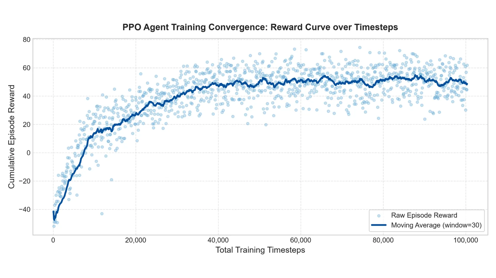
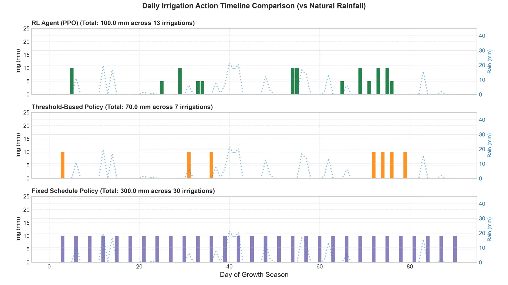
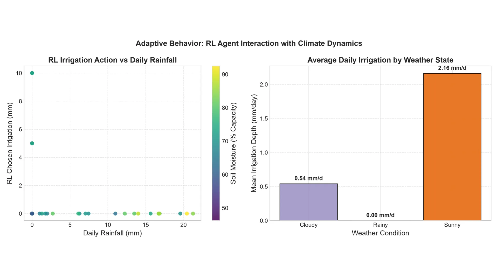
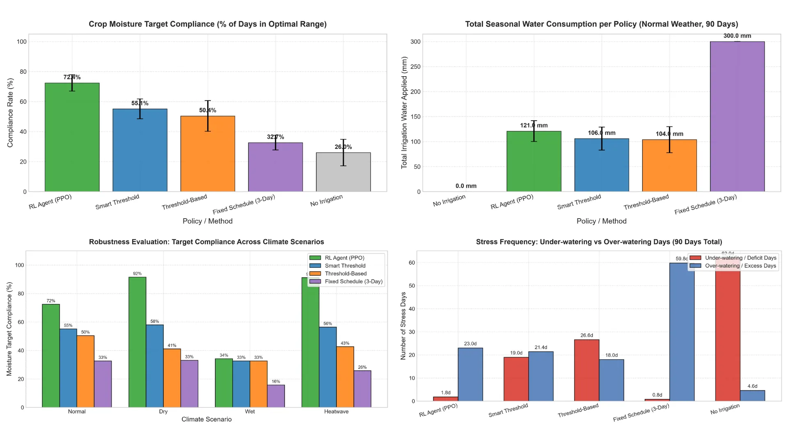

# Smart Irrigation Scheduling Through Reinforcement Learning




## Project Overview

Smart Irrigation Scheduling Through Reinforcement Learning is a model-centric reinforcement learning system designed to optimize daily agricultural irrigation decisions across a 90-day crop growth season. Implemented using a custom Gymnasium agro-hydrological environment and a Proximal Policy Optimization (PPO) agent via Stable-Baselines3, the project balances crop moisture target compliance against water conservation under stochastic weather regimes. The repository spans hydrological simulation, agent training, deterministic multi-scenario benchmarking against four baseline policies, high-resolution scientific visualization, unit tests, and an interactive dark-mode Streamlit dashboard.

## Problem Statement & Objectives

Conventional irrigation schedules rely on fixed calendar intervals or static moisture sensor thresholds, which frequently cause water waste, nutrient leaching, root anoxia, or drought stress during sensitive phenological stages. Because fixed schedules ignore rainfall and threshold triggers act only reactively after soil moisture drops, neither approach anticipates stage-dependent evapotranspiration demand or incoming precipitation.

The primary objectives of this project are:

- Formulate daily irrigation scheduling over a 90-day crop cycle as a discrete-time Markov Decision Process (MDP) grounded in FAO-56 soil water balance and crop coefficient ($K_c$) dynamics.
- Train a Proximal Policy Optimization (PPO) agent using a 7-dimensional normalized state representation without future data leakage and a multi-objective reward function.
- Evaluate policy performance and climate robustness against Fixed Schedule, Threshold-Based, Smart Threshold, and No Irrigation baselines across Normal, Dry, Wet, and Heatwave scenarios over five random seeds.
- Provide reproducible training, evaluation, and scientific plotting pipelines alongside an interactive Streamlit simulation and benchmark explorer.

## Data & Input Sources

No standalone static training dataset is used in this project; instead, training and evaluation experiences are generated dynamically through `SmartIrrigationEnv` and `WeatherModel`, which simulate daily weather transitions, temperature, precipitation, reference evapotranspiration ($ET_0$), crop evapotranspiration ($ET_c$), surface runoff, and deep percolation drainage from parameters in [config/config.yaml](config/config.yaml). Recorded training histories, multi-seed evaluation benchmarks, and representative daily trajectories are persisted in `logs/` and `metrics/`.

| Dataset / Input Source | Source | Format | Samples / Records | Features / Input Shape | Target / Output |
| :--- | :--- | :--- | :--- | :--- | :--- |
| Agro-Hydrological Simulator | `SmartIrrigationEnv` & `WeatherModel` | Gymnasium `Box` / `Discrete` | 90 steps/episode (~1,115 train episodes) | 7 normalized state features (`float32`, `[0, 1]`) | 4 discrete irrigation actions (`0, 5, 10, 20 mm`) |
| Training History Log | [logs/training_history.csv](logs/training_history.csv) | CSV | 1,115 episode records | `timestep`, `episode_reward`, `episode_length`, `reward_rolling_mean` | Episode return progression |
| Multi-Scenario Evaluation Logs | [metrics/evaluation_episodes.csv](metrics/evaluation_episodes.csv) | CSV | 100 episodes (4 scenarios × 5 policies × 5 seeds) | 11 scenario, policy, seed, and metric columns | Seasonal water, compliance, stress, WUE |
| Representative Trajectories | [metrics/representative_trajectories.json](metrics/representative_trajectories.json) | JSON | 20 trajectories (90 daily steps each) | 25 daily state, weather, reward, and action fields | Policy comparison and plotting |

### Data Preprocessing & Feature Engineering

Each simulation step constructs a leakage-free 7-dimensional observation vector clipped strictly to `[0.0, 1.0]` inside `SmartIrrigationEnv._get_observation()`, transforming raw physical soil water depth, air temperature, precipitation, sky state, phenological growth stage, estimated crop evapotranspiration demand, and season progress into scale-invariant neural network inputs. Effective rainfall is simultaneously adjusted for surface runoff when precipitation exceeds `10.0 mm/day`.

| Transformation / Feature | Raw Input | Normalized / Engineered Output | Purpose |
| :--- | :--- | :--- | :--- |
| Soil Moisture Ratio | `soil_moisture_mm` (`0–100 mm`) | `clip(S_t / 100.0, 0, 1)` | Represents available root-zone water fraction |
| Temperature Normalization | `temperature` (`10–48 °C`) | `clip((T_t - 15.0) / 30.0, 0, 1)` | Captures thermal evaporation driver |
| Rainfall Normalization | `rainfall` (`0–80 mm/day`) | `clip(P_t / 50.0, 0, 1)` | Signals natural precipitation supply |
| Weather State Encoding | Discrete Markov state (`0, 1, 2`) | `state / 2.0` (`0.0, 0.5, 1.0`) | Encodes Sunny, Cloudy, and Rainy conditions |
| Growth Stage & Demand | Current day (`0–90`), `Kc`, `ET0` | `stage_idx / 3.0`, `clip((Kc * ET0) / 10.0, 0, 1)` | Aligns policy with phenological sensitivity and daily $ET_c$ |

Sequence executed at each step:

1. Retrieve active FAO-56 growth stage metadata (`Initial`, `Development`, `Mid-Season`, `Late-Season`) for `current_day` to obtain crop coefficient $K_c$, moisture target band, and stress multiplier.
2. Compute daily reference evapotranspiration $ET_0$ from simulated air temperature and solar radiation factor ($1.25$ Sunny, $0.85$ Cloudy, $0.45$ Rainy), then derive crop demand $ET_c = K_c \times ET_0$.
3. Apply runoff attenuation (`runoff_coefficient = 0.15`) to rainfall above `10.0 mm` and deep percolation drainage (`drainage_rate = 0.50`) above field capacity (`80.0 mm`).
4. Pack and clip all seven state variables into a `float32` vector in `[0, 1]` prior to policy action selection.

## Tech Stack

| Category | Technology | Purpose |
| :--- | :--- | :--- |
| Programming Language | Python | Core simulation, training, evaluation, testing, and UI implementation |
| RL Environment API | Gymnasium | Standardized `Env`, `Box` observation space, and `Discrete` action space |
| RL Framework | Stable-Baselines3 | PPO implementation, `Monitor` wrapper, and model serialization (`.zip`) |
| Deep Learning Backend | PyTorch | Actor-critic MLP policy/value networks (`Tanh` activations) and gradient optimization |
| Numerical & Tabular Data | NumPy, Pandas | Stochastic weather modeling, water balance math, and CSV metric aggregation |
| Visualization | Matplotlib | 300 DPI scientific plots and Streamlit embedded charts |
| Configuration | PyYAML | Centralized environment, weather, training, and evaluation configuration |
| Testing | Pytest | Automated verification of MDP bounds, hydrology physics, and reward behavior |
| Interactive Dashboard | Streamlit | Multi-page dark-mode simulation, benchmark gallery, and MDP viewer |

## Machine Learning Approach

The system adopts a **Reinforcement Learning** approach, modeling irrigation control as an episodic finite-horizon Markov Decision Process $\mathcal{M} = \langle \mathcal{S}, \mathcal{A}, \mathcal{P}, \mathcal{R}, \gamma \rangle$ over 90 daily steps. At each step, the agent observes soil moisture, meteorological conditions, crop phenology, and estimated daily crop evapotranspiration ($ET_c$), and selects an irrigation depth from four discrete volumes (`0, 5, 10, 20 mm`) to maximize cumulative multi-objective reward.

| Attribute | Implementation Detail |
| :--- | :--- |
| Learning Paradigm | Reinforcement Learning |
| Problem Domain | Precision Agriculture & Agro-Hydrological Control |
| ML Task | Sequential Decision-Making / Discrete Irrigation Scheduling |
| State Input | 7D normalized continuous vector (`Box(0.0, 1.0, shape=(7,), float32)`) |
| Action Output | 4 discrete irrigation levels (`0.0 mm`, `5.0 mm`, `10.0 mm`, `20.0 mm`) |
| Reward Formulation | Parabolic target-range bonus minus stage-weighted deficit, excess moisture, water volume, and rain-waste penalties |

## Model Overview

The learned controller is a custom **PPO Actor-Critic MLP** trained from scratch within `SmartIrrigationEnv` under the `normal` weather regime (`seed=42`). Separate policy (`pi`) and value (`vf`) networks with two hidden layers of 128 units each and `Tanh` activations map the 7-dimensional observation vector to categorical action logits and state-value estimates.

| Attribute | Detail |
| :--- | :--- |
| Model Name | PPO Irrigation Scheduling Agent (`ppo_irrigation_agent.zip`) |
| Algorithm / Architecture | Proximal Policy Optimization (`MlpPolicy`: `pi=[128, 128]`, `vf=[128, 128]`, `Tanh`) |
| Model Type | On-policy Actor-Critic Reinforcement Learning |
| Framework | Stable-Baselines3 / PyTorch |
| Pretrained Status | Trained from scratch in this project (`100,000` timesteps, `1,115` episodes) |
| Saved Checkpoint | [models/ppo_irrigation_agent.zip](models/ppo_irrigation_agent.zip) |

## ML Workflow

The end-to-end research and engineering workflow documented in [final_report.md](final_report.md) proceeds through the following stages:

1. **Configuration & Hydrological Parameterization**: Define soil capacity (`100.0 mm`), wilting point (`20%`), field capacity (`80%`), FAO-56 crop stage parameters, reward weights, and climate transition matrices in [config/config.yaml](config/config.yaml).
2. **Environment & Weather Modeling**: Simulate daily 3-state Markov weather (`Sunny`, `Cloudy`, `Rainy`) and FAO-56 soil water balance transitions in [src/environment/weather_model.py](src/environment/weather_model.py) and [src/environment/irrigation_env.py](src/environment/irrigation_env.py).
3. **Unit & Physics Verification**: Validate observation/action spaces, moisture bounds, drainage behavior, deficit penalties, and scenario diversity in [tests/test_environment.py](tests/test_environment.py) and [tests/test_simulation.py](tests/test_simulation.py).
4. **PPO Policy Training & Logging**: Train `MlpPolicy` for `100,000` timesteps using `TrainingMetricsCallback` in [src/agents/train_agent.py](src/agents/train_agent.py), logging episode rewards to [logs/training_history.csv](logs/training_history.csv) and [metrics/training_summary.json](metrics/training_summary.json).
5. **Multi-Scenario Baseline Benchmarking**: Evaluate the trained PPO agent deterministically alongside four baselines from [src/baselines/baseline_policies.py](src/baselines/baseline_policies.py) across four climates and five seeds in [src/evaluation/evaluate.py](src/evaluation/evaluate.py).
6. **Scientific Plotting & Interactive Serving**: Generate eight 300 DPI figures in [src/visualization/plot_results.py](src/visualization/plot_results.py) and serve interactive simulations in [streamlit/app.py](streamlit/app.py).

## ML Pipeline Architecture

The pipeline couples the `WeatherModel` Markov weather generator with `SmartIrrigationEnv` to produce daily observations and multi-objective rewards, feeding Stable-Baselines3 PPO rollouts during training and enabling deterministic evaluation against heuristic baselines and interactive visualization in Streamlit.



## Model Training & Configuration

Training was performed from scratch using [src/agents/train_agent.py](src/agents/train_agent.py) on the `normal` weather scenario with random seed `42` for `100,000` total timesteps (`1,115` completed 90-day episodes, taking `108.42` seconds on local CPU). Because `Monitor` wraps the environment during training, logged episode returns climb from an initial minimum of `-51.896` to a converged final mean reward of `+48.214` (maximum `+74.413`).

| Parameter | Configured Value | Description |
| :--- | :--- | :--- |
| Algorithm | `PPO` | Clipped surrogate actor-critic policy optimization |
| Policy Network | `MlpPolicy` (`pi=[128, 128]`, `vf=[128, 128]`, `Tanh`) | Separate actor and critic MLPs |
| Total Timesteps | `100,000` | Total environment interaction steps (`1,115` episodes) |
| Learning Rate | `0.0003` | Adam optimizer step size |
| Rollout Steps (`n_steps`) | `1,024` | Steps collected per rollout buffer |
| Mini-Batch Size | `64` | Gradient update batch size |
| Optimization Epochs (`n_epochs`) | `10` | Passes over rollout buffer per update |
| Discount Factor (`gamma`) | `0.99` | Long-horizon return weighting |
| GAE Lambda (`gae_lambda`) | `0.95` | Advantage estimation bias-variance trade-off |
| Clip Range (`clip_range`) | `0.2` | PPO surrogate objective clipping bound |
| Entropy / Value Coefs | `ent_coef=0.01`, `vf_coef=0.5`, `max_grad_norm=0.5` | Exploration regularization, critic loss weight, gradient clipping |
| Seed | `42` | Reproducibility seed across NumPy, PyTorch, and environment |

```bash
python -m src.agents.train_agent --config config/config.yaml --timesteps 100000 --seed 42
```

### Model Comparison & Selection

Deterministic evaluation in [src/evaluation/evaluate.py](src/evaluation/evaluate.py) compares the trained `RL Agent (PPO)` against four conventional baselines (`Smart Threshold`, `Threshold-Based`, `Fixed Schedule (3-Day)`, and `No Irrigation`) across all four climate scenarios (`normal`, `dry`, `wet`, `heatwave`) and five independent evaluation seeds (`[101, 202, 303, 404, 505]`). Note that `train_agent.py` writes outputs under `outputs/logs/` and `outputs/metrics/`, while the repository stores the checked-in artifacts directly under `logs/` and `metrics/`.

| Scenario | Policy | Mean Reward | Water Applied (mm) | Target Compliance (%) | Deficit Days | Excess Days | WUE |
| :--- | :--- | :---: | :---: | :---: | :---: | :---: | :---: |
| Normal | **RL Agent (PPO)** | **54.63 ± 5.92** | **121.0 ± 20.74** | **72.45 ± 5.41** | **1.8 ± 1.64** | 23.0 ± 6.00 | **5.46 ± 0.56** |
| Normal | Smart Threshold | 31.67 ± 5.10 | 106.0 ± 23.02 | 55.11 ± 6.60 | 19.0 ± 4.00 | 21.4 ± 7.20 | 4.82 ± 1.05 |
| Normal | Threshold-Based | 24.25 ± 9.45 | 104.0 ± 26.08 | 50.45 ± 10.23 | 26.6 ± 5.81 | 18.0 ± 8.12 | 4.63 ± 1.79 |
| Normal | Fixed Schedule (3-Day) | 1.90 ± 4.95 | 300.0 ± 0.00 | 32.67 ± 4.88 | 0.8 ± 1.10 | 59.8 ± 4.09 | 0.98 ± 0.15 |
| Normal | No Irrigation | -81.54 ± 44.37 | 0.0 ± 0.00 | 26.00 ± 8.84 | 62.0 ± 8.72 | 4.6 ± 4.88 | 23.40 ± 7.96 |
| Dry | **RL Agent (PPO)** | **65.87 ± 5.82** | 348.0 ± 19.56 | **91.56 ± 5.91** | **1.8 ± 0.84** | 5.8 ± 4.66 | **2.38 ± 0.23** |
| Heatwave | **RL Agent (PPO)** | **61.40 ± 2.64** | 407.0 ± 18.91 | **91.11 ± 3.04** | **2.0 ± 1.22** | 6.0 ± 2.92 | **2.02 ± 0.09** |
| Wet | **RL Agent (PPO)** | **16.68 ± 4.74** | **6.0 ± 6.52** | **34.22 ± 3.72** | **0.0 ± 0.00** | 59.2 ± 3.35 | **35.07 ± 16.24** |

### Model Artifacts & Checkpoints

All trained weights, training logs, and benchmark outputs generated by the project are tracked in the repository for immediate inspection and Streamlit inference.

| Artifact Name | Format | Purpose | Location |
| :--- | :--- | :--- | :--- |
| `ppo_irrigation_agent.zip` | ZIP (SB3) | Trained PPO actor-critic weights and policy metadata | [models/ppo_irrigation_agent.zip](models/ppo_irrigation_agent.zip) |
| `training_history.csv` | CSV | Per-episode timesteps, rewards, lengths, and rolling mean | [logs/training_history.csv](logs/training_history.csv) |
| `training_summary.json` | JSON | Training duration, final reward summary, and hyperparameters | [metrics/training_summary.json](metrics/training_summary.json) |
| `evaluation_summary.csv` | CSV | Mean and standard deviation across 4 scenarios and 5 policies | [metrics/evaluation_summary.csv](metrics/evaluation_summary.csv) |
| `evaluation_episodes.csv` | CSV | Raw metrics for all 100 multi-seed evaluation episodes | [metrics/evaluation_episodes.csv](metrics/evaluation_episodes.csv) |
| `representative_trajectories.json` | JSON | Full 90-day daily trajectories per scenario and policy | [metrics/representative_trajectories.json](metrics/representative_trajectories.json) |

## Model Evaluation & Results

Evaluation was executed deterministically (`deterministic=True`) over 100 unseen-seed episodes (`4 scenarios × 5 policies × 5 seeds = 9,000` simulated days) in [src/evaluation/evaluate.py](src/evaluation/evaluate.py), distinct from the `normal` training rollouts (`seed=42`). Under the `normal` scenario, the PPO agent achieves `72.45%` moisture target compliance while using `121.0 mm` of water—a `59.67%` reduction compared to `Fixed Schedule (3-Day)` (`300.0 mm`, `32.67%` compliance)—and maintains `91.56%` and `91.11%` target compliance under `dry` and `heatwave` stress regimes, respectively.

| Metric (Normal Scenario, 5 Seeds) | RL Agent (PPO) | Smart Threshold | Fixed Schedule (3-Day) | No Irrigation |
| :--- | :---: | :---: | :---: | :---: |
| Cumulative Reward | `54.63 ± 5.92` | `31.67 ± 5.10` | `1.90 ± 4.95` | `-81.54 ± 44.37` |
| Total Water Applied (mm) | `121.0 ± 20.74` | `106.0 ± 23.02` | `300.0 ± 0.00` | `0.0 ± 0.00` |
| Target Compliance (%) | `72.45 ± 5.41` | `55.11 ± 6.60` | `32.67 ± 4.88` | `26.00 ± 8.84` |
| Deficit Stress Days | `1.8 ± 1.64` | `19.0 ± 4.00` | `0.8 ± 1.10` | `62.0 ± 8.72` |
| Excess Water Days | `23.0 ± 6.00` | `21.4 ± 7.20` | `59.8 ± 4.09` | `4.6 ± 4.88` |
| Water Use Efficiency (WUE) | `5.46 ± 0.56` | `4.82 ± 1.05` | `0.98 ± 0.15` | `23.40 ± 7.96` |

Key evaluation findings and simulation limitations:

- **Proactive Phenological Adaptation**: By observing growth stage (`obs[4]`) and daily $ET_c$ (`obs[5]`), the PPO agent raises root-zone moisture ahead of the flowering stage (`days 51–75`, $K_c=1.15$, target `65%–85%`), cutting deficit stress to `1.8–2.0 days` across Normal, Dry, and Heatwave scenarios.
- **Precipitation-Aware Conservation**: Under the `wet` monsoon scenario, PPO applies only `6.0 ± 6.52 mm` of water across 90 days (`0.0` deficit days), avoiding rain-waste penalties and matching rainfed compliance without unnecessary pumping.
- **Single-Bucket Simulation Assumption**: Soil moisture is modeled as a homogeneous single-layer root-zone reservoir (`100.0 mm`) without salinity dynamics, multi-layer vertical infiltration, or sensor measurement noise.

## Results Visualization & Preview

### 1. Interactive 90-Day Simulation & Baseline Benchmark Dashboard

The live simulation dashboard in Streamlit lets users select climate scenarios, random seeds, and initial soil moisture while displaying comparative KPI cards (`+66.7%` water conservation, `68.9%` compliance, `0` deficit days, and `51.3` cumulative reward on `normal` seed `101`) alongside the 90-day soil moisture trajectory.

### 2. Scientific Benchmark Gallery & PPO Training Convergence View

The benchmark gallery view embeds the pre-computed scientific figures with interpretive captions, highlighting the PPO training convergence curve where raw episode rewards climb from negative initial penalties to a stable `+50.0` moving-average plateau over `100,000` timesteps.

### 3. System Architecture & Hydrological MDP Formulation View

The architecture documentation tab presents the complete MDP formulation, detailing the 7-dimensional normalized state vector $\mathcal{S} \in \mathbb{R}^7$, the 4 discrete irrigation actions $\mathcal{A} = \{0, 1, 2, 3\}$, the mass-conserving soil water balance equation, the multi-objective reward structure, and FAO-56 crop stage parameters.

### 4. Soil Moisture Trajectory Across 90-Day Crop Growth Season

Over a representative 90-day normal-weather episode, the PPO agent (green solid curve) tracks the shifting FAO stage-specific optimal moisture band closely—rising cleanly into the `65%–85%` flowering band—whereas Fixed Schedule causes frequent over-watering above the `80%` field capacity and No Irrigation drops below the `20%` permanent wilting point.

### 5. PPO Agent Training Convergence Curve

The 30-episode moving average of cumulative episode reward rises steeply from `-46.8` in early exploration to cross `+20.0` around `15,000–25,000` timesteps and stabilizes around `+48.2` to `+54.0` through `100,000` timesteps, confirming stable on-policy convergence.

### 6. Daily Irrigation Action Timeline vs. Natural Rainfall

Comparing daily irrigation depths against natural rainfall shows that the PPO agent (`100.0 mm` across `13` irrigations) withholds irrigation during heavy rain events and concentrates `5–10 mm` doses during dry spells and flowering, while Fixed Schedule blindly applies `10 mm` every three days (`300.0 mm` total) regardless of rainfall.

### 7. Adaptive Behavior: RL Irrigation Action vs. Climate Dynamics

The left scatter panel verifies that PPO consistently selects `0 mm` irrigation whenever daily rainfall occurs (`> 0 mm`), while the right bar chart shows mean daily irrigation scaling monotonically with evaporative demand: `2.16 mm/day` on Sunny days, `0.54 mm/day` on Cloudy days, and `0.00 mm/day` on Rainy days.

### 8. Multi-Metric Benchmark & Cross-Climate Robustness Summary

This four-panel summary aggregates normal-weather compliance (`72.4%` PPO vs. `32.7%` Fixed Schedule), seasonal water use (`121.0 mm` PPO vs. `300.0 mm` Fixed Schedule), stress-day frequencies (`1.8d` deficit for PPO vs. `62.0d` deficit for No Irrigation and `59.8d` excess for Fixed Schedule), and cross-climate robustness where PPO maintains `92%` (`Dry`) and `91%` (`Heatwave`) compliance.

## Prerequisites

- Python 3.10 or higher
- `pip` package manager
- CPU execution is sufficient for both PPO training (~108 seconds for `100,000` timesteps) and Streamlit inference (GPU is not required)
- Dependencies listed in [requirements.txt](requirements.txt): `gymnasium>=1.0.0`, `stable-baselines3>=2.3.0`, `torch>=2.0.0`, `numpy>=1.24.0`, `pandas>=2.0.0`, `matplotlib>=3.7.0`, `pyyaml>=6.0`, `pytest>=7.0.0`, `streamlit>=1.30.0`

## Installation & Setup

1. Clone the repository and enter the project directory:
   ```bash
   git clone https://github.com/weztcy/Smart-Irrigation-Scheduling-Through-Reinforcement-Learning.git
   cd "Smart Irrigation Scheduling Through Reinforcement Learning"
   ```
2. Create and activate a virtual environment:
   ```bash
   python -m venv .venv
   # Windows PowerShell:
   .\.venv\Scripts\Activate.ps1
   # Linux / macOS:
   source .venv/bin/activate
   ```
3. Install the required dependencies:
   ```bash
   pip install -r requirements.txt
   ```

## Usage & Execution

Once dependencies are installed, you can verify the environment tests, run deterministic benchmark evaluations, regenerate figures, or launch the interactive Streamlit dashboard from the repository root:

1. Run the unit and hydrological simulation test suite:
   ```bash
   python -m pytest tests/ -v
   ```
2. Evaluate the pretrained PPO checkpoint (`models/ppo_irrigation_agent.zip`) against all baseline policies:
   ```bash
   python -m src.evaluation.evaluate --config config/config.yaml --model models/ppo_irrigation_agent.zip
   ```
3. Launch the interactive Streamlit application (dark-mode simulation, benchmark gallery, and MDP reference):
   ```bash
   streamlit run streamlit/app.py
   ```

## Reproducibility & Execution

Training, evaluation, and plotting are deterministic with respect to the seeds declared in [config/config.yaml](config/config.yaml) (`seed: 42` for training; `seeds: [101, 202, 303, 404, 505]` for evaluation across `normal`, `dry`, `wet`, and `heatwave`). Note that `train_agent.py`, `evaluate.py`, and `plot_results.py` write outputs to `outputs/logs/`, `outputs/metrics/`, and `outputs/figures/` by default, whereas the repository's pre-computed artifacts are stored in `logs/`, `metrics/`, and `figures/`. Minor numerical variance may occur across different PyTorch or CPU hardware versions.

1. Retrain the PPO agent from scratch using the exact training seed (`42`) and `100,000` timesteps:
   ```bash
   python -m src.agents.train_agent --config config/config.yaml --timesteps 100000 --seed 42
   ```
2. Run the multi-scenario, multi-seed evaluation script (`outputs/metrics/`):
   ```bash
   python -m src.evaluation.evaluate --config config/config.yaml --model models/ppo_irrigation_agent.zip
   ```
3. Regenerate all eight 300 DPI scientific figures from the evaluation outputs:
   ```bash
   python -m src.visualization.plot_results
   ```

## Contributing

Contributions are welcome to improve the agro-hydrological model, training pipeline, or evaluation suite. Please follow this standard workflow:

1. Fork the repository.
2. Create a branch for the change.
3. Make the changes.
4. Run relevant checks or tests when available (`python -m pytest tests/ -v`).
5. Commit and push the branch.
6. Open a pull request with a clear explanation.

## License

This project is licensed under the MIT License.
See the [LICENSE](LICENSE) file for details.

## Author & Contact

**Yohanes Dimas Pratama**

- GitHub: [github.com/weztcy](https://github.com/weztcy)
- Portfolio: [yohanesdimas.com](https://yohanesdimas.com)
- LinkedIn: [linkedin.com/in/yohanes-dimas](https://www.linkedin.com/in/yohanes-dimas)
